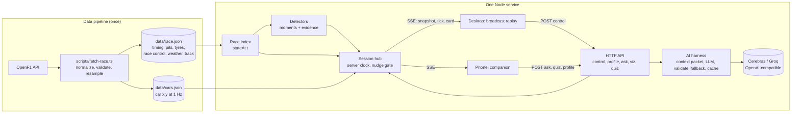
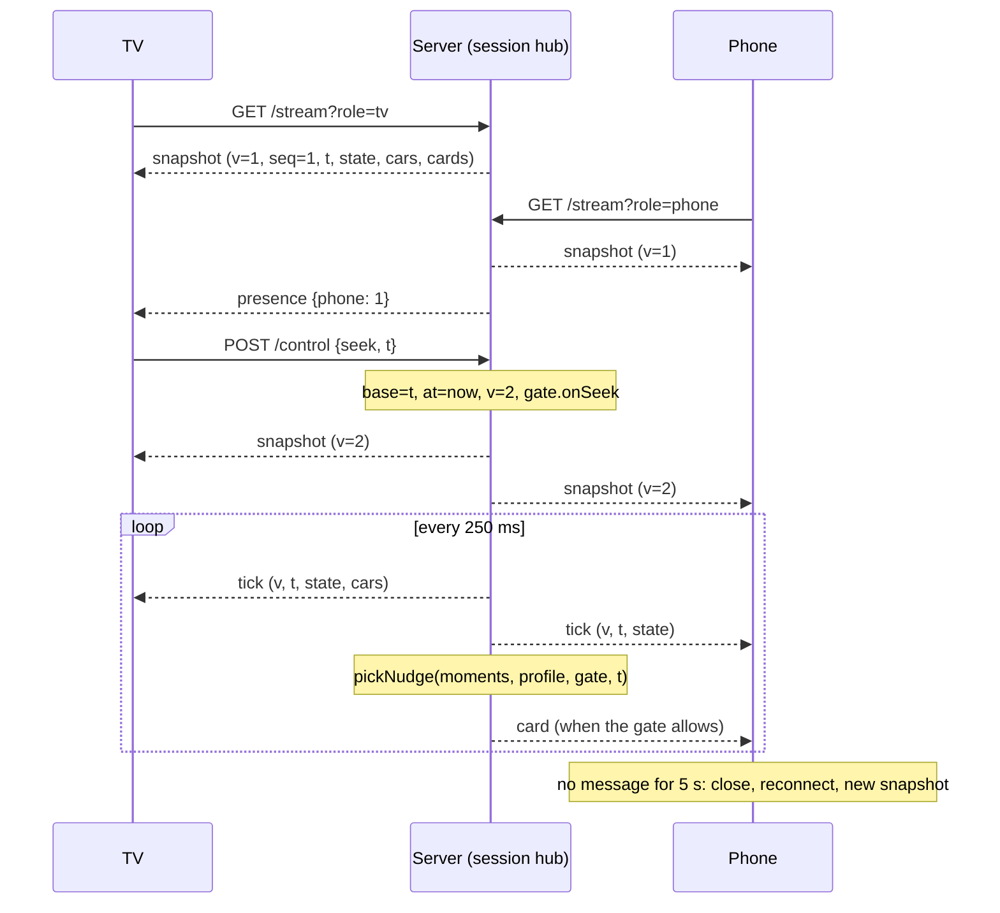
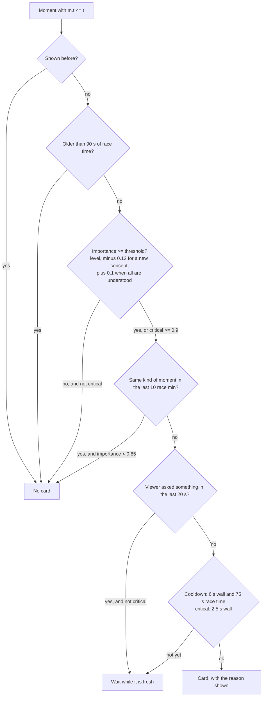

# Khel Saathi: technical design

## High-level design



## Folder map

| Path | What it holds |
|---|---|
| `scripts/fetch-race.ts` | Data pipeline: download, normalize, red-flag window, track outline, 1 Hz car frames, chronological validation |
| `src/shared/types.ts` | All shared types: race data, live state, moments, charts, cards |
| `src/shared/race.ts` | `indexRace`, `stateAt(t)`, track status timeline, stints visible at a lap. The only door to the data |
| `src/shared/detect.ts` | Detectors: bursts and charges, pit windows, VSC/SC/red flag/restart, red-flag strategy, lead changes |
| `src/shared/gate.ts` | Nudge gate: importance, level, concept knowledge, repeats, cooldowns, busy viewer, no duplicates |
| `src/shared/concepts.ts` | Concept pack (8 concepts, 2 depths, 2 languages, analogies, quick checks) and knowledge transitions |
| `src/shared/history.ts` | Curated history with sources, tag matching |
| `src/shared/copy.ts` | Instant card templates and default chart per moment type |
| `src/shared/context.ts` | AI harness without I/O: intent, context packet, system prompt, validation, future-leak check, fallback |
| `src/shared/viz.ts` | Chart data at t, chart request validation |
| `src/shared/wire.ts` | SSE message types, the client accept rule, car interpolation |
| `backend/src/sessions.ts` | Session hub: clock, controls, SSE clients, 250 ms loop, nudges, persistence |
| `backend/src/ai.ts` | LLM call (timeout, failover, JSON mode), cache |
| `backend/src/api.ts` | Transport-independent `handle(req)` router |
| `backend/src/server.ts` | `node:http` server: SSE stream, API, static app |
| `src/store.ts` | zustand store: snapshot and tick handling, watchdog, actions |
| `src/ui/*` | Broadcast, TrackMap, Companion, charts, kit |

## Sync protocol



Client rule (`accept` in `src/shared/wire.ts`, tested):
- A snapshot always applies, and it resets the connection's sequence.
- Drop a message with `seq <= lastSeq`.
- Drop a tick with `v < currentV`. It was sent before a clock change landed.
- On `v > currentV` (a missed snapshot), fetch `GET /api/sessions/:id` and resync.

## Nudge gate



A blocked moment stays a candidate while it is fresh. A short cooldown delays a card. It does not drop it.

## AI harness

1. **Intent** (deterministic regex): spoiler, history, positions, tyres, gaps, concept, or moment.
2. **Spoiler intent**: answer from data, no model call.
3. **Instant chart**: the intent picks the chart. The server builds it at the session's time t, and the phone shows it while the model works.
4. **Context packet** (`buildContext`): replay note, lap, track status, wet flag, top 10 plus any named drivers (gap, interval, tyre, tyre age, stops, places gained), recent moments with their evidence, the viewer's level, language, depth and concept states, concept notes, and the history match only when strong. The allowed chart types are listed.
5. **Model call**: JSON mode, temperature 0.3, 9-second timeout, failover from `LLM_*` to `LLM2_*` to `LLM3_*`.
6. **Validation**: shape, lengths, a known chart type and drivers, known concepts. `then_now` only when the packet had history.
7. **Future-leak check**: an answer that talks about the ending ("went on to", "won the race", ...) is dropped.
8. **Fallback**: a template answer from the latest moment or the concept pack, marked "data-only".
9. **Cache**: the key holds the question, moment, lap, latest visible moment, level, language and concept states.

## Tests

```bash
npm test
```

| File | What it proves |
|---|---|
| `detect.test.ts` | Detectors are reproducible. The three demo scenes are found at the race-control times. Status timeline. Classification order. A running stint never shows its end. Charts stop at the current lap. Pit-lane flags. |
| `gate.test.ts` | No duplicates (also after a seek back), no future, no stale moments. Beginners get more cards than experts. Busy viewer. Cooldown. Repeats. Knowledge raises the bar. A whole-race run gives a readable number of cards. |
| `spoiler.test.ts` | Context and charts at seven times equal those built from data cut at that time. Spoiler questions never reach the model. Ending-talk answers are replaced. No cache reuse after a seek back. The fallback uses only past moments. |
| `sync.test.ts` | Real HTTP and SSE: snapshot on connect, seek, speed, play, pause, reconnect, client accept rule, nudge sent once, hidden after a seek back, not re-sent, bad input rejected. |
